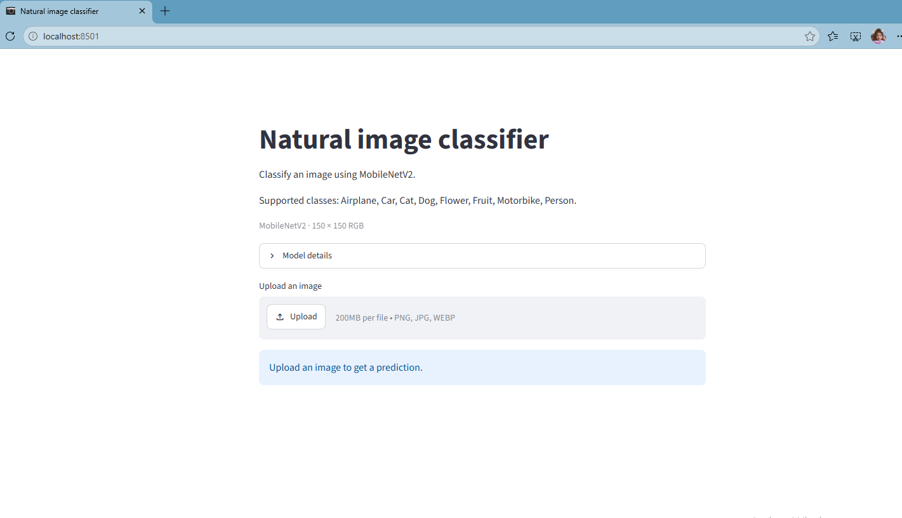
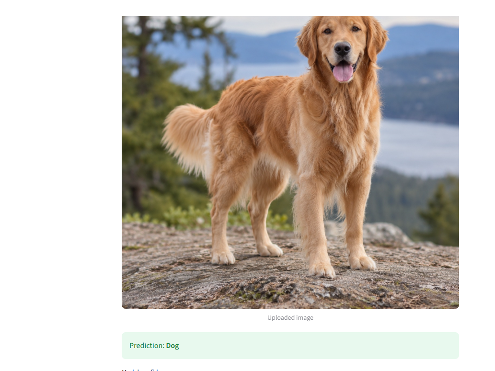
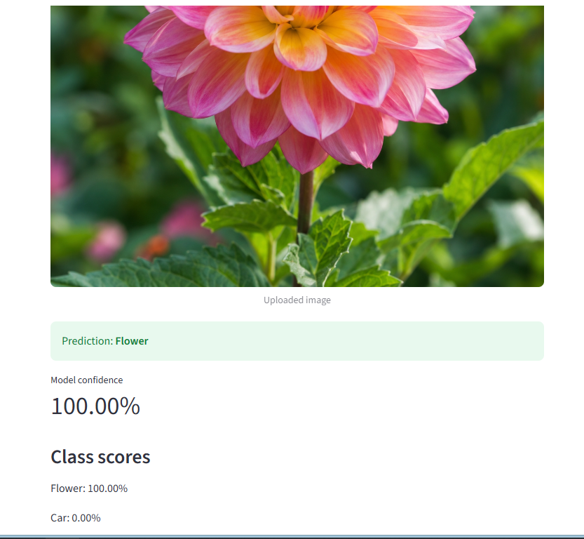
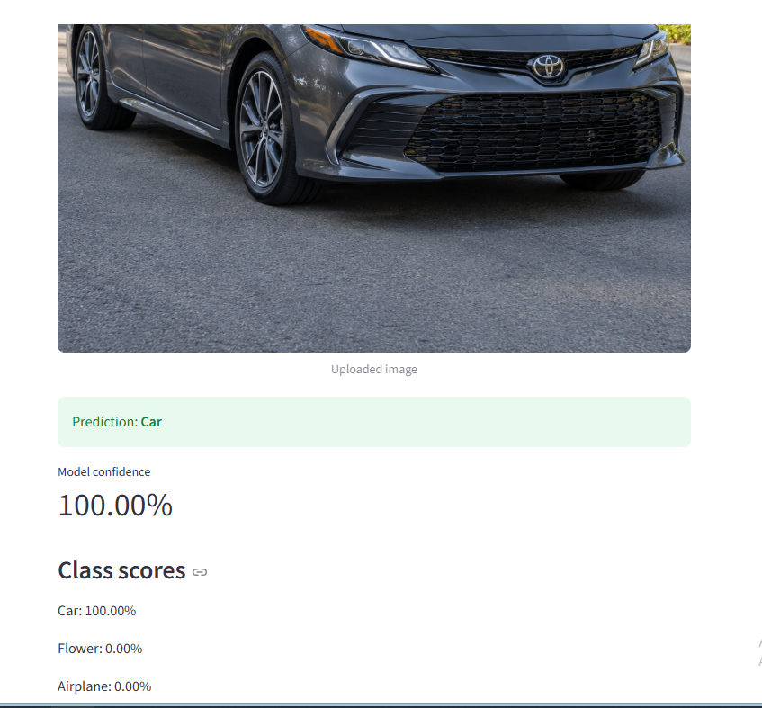

# Classification d'images naturelles avec MobileNetV2 et Streamlit

Application web qui reconnaît la catégorie d'une image parmi **8 classes** et affiche un score de confiance.

Réalisé par :agrigah aya



## Fonctionnalités

- Import d'une image (PNG, JPG, JPEG, WEBP).
- Prédiction de la catégorie avec le score de confiance.
- Affichage des scores des 8 classes, du plus élevé au plus faible.
- Messages d'erreur clairs si le fichier est illisible.

**Classes reconnues** (dans l'ordre de sortie du modèle) :
`airplane`, `car`, `cat`, `dog`, `flower`, `fruit`, `motorbike`, `person`.

## Aperçu des résultats

| Chien | Fleur | Voiture |
| --- | --- | --- |
|  |  |  |
| Prédiction : **Dog** | **Flower** (100,00 %) | **Car** (100,00 %) |

## Structure du projet

| Fichier | Rôle |
| --- | --- |
| `streamlit_natural_images.py` | Application Streamlit |
| `mobilenetv2_natural_images.keras` | Modèle MobileNetV2 entraîné |
| `natural_images_class_names.json` | Noms des classes, dans l'ordre du modèle |
| `natural_images_config.json` | Nom du modèle, taille d'entrée, type de prétraitement |
| `verify_natural_images.py` | Script de vérification du modèle |
| `requirements.txt` | Dépendances Python |
| `run_app.bat` | Lanceur Windows |

## Installation

Prérequis : **Python 3.12** (TensorFlow ne fonctionne pas encore avec Python 3.14).

```powershell
python -m venv .venv
.venv\Scripts\activate
python -m pip install --upgrade pip
python -m pip install -r requirements.txt
```

## Lancement

```powershell
python -m streamlit run streamlit_natural_images.py
```

ou double-clic sur `run_app.bat`. L'application s'ouvre sur <http://localhost:8501>. Arrêt avec `Ctrl+C` dans le terminal.

## Le modèle

| Élément | Valeur |
| --- | --- |
| Architecture | MobileNetV2 + `GlobalAveragePooling2D` + `Dropout` + `Dense(8, softmax)` |
| Entrée | image RGB 150 × 150 |
| Sortie | 8 probabilités |
| Paramètres | 2 268 232 |

Le principe est le *transfer learning* : MobileNetV2 extrait 1280 caractéristiques de l'image et la dernière couche les classe dans les 8 catégories.

## Fonctionnement de l'application

1. Chargement du modèle, des classes et de la configuration (mis en cache).
2. Vérification de la cohérence : nombre de classes, taille d'entrée.
3. Import de l'image par l'utilisateur.
4. Prétraitement : correction de l'orientation, conversion RGB, redimensionnement 150 × 150, puis `mobilenet_v2.preprocess_input` (valeurs entre −1 et 1). Le modèle n'ayant pas de couche de normalisation, ce prétraitement est appliqué **une seule fois**, dans l'application.
5. Prédiction, puis affichage de la classe, de la confiance et de tous les scores.

## Limites

- Les tests réalisés portent sur peu d'images : ils ne constituent pas une mesure de précision.
- Un score de 100 % ne garantit pas que la prédiction est correcte.
- Le modèle choisit toujours l'une des 8 classes, même pour une image qui n'appartient à aucune.
- L'ordre des classes et le prétraitement MobileNetV2 standard sont ceux fournis avec le modèle ; ils sont à confirmer avec le notebook d'entraînement d'origine (`training_metadata_confirmed` dans la configuration).

## Pistes d'amélioration

- Évaluer le modèle sur un jeu de test séparé (précision, matrice de confusion).
- Ajouter un seuil de confiance ou une classe « autre » pour rejeter les images hors sujet.
- Affiner le modèle avec davantage d'images.

## Dépannage

- `streamlit` ou `tensorflow` introuvable : activer le `.venv` puis relancer `python -m pip install -r requirements.txt`.
- `No Python at ...` : le `.venv` vient d'un autre ordinateur ; le supprimer et le recréer avec Python 3.12.
- Port 8501 occupé : arrêter l'ancienne instance (`Ctrl+C`) ou lancer avec `--server.port 8502`.
